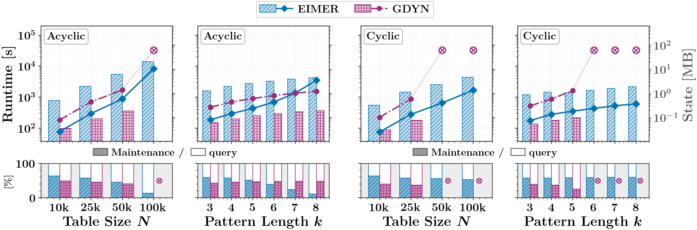

# Fig. 10a: EIMER and GDYN on acyclic and cyclic queries, on Trino

| Parameter | Value |
|---|---|
| Paper | Fig. 10a |
| Approaches | EIMER (clique-grow's pick), GDYN |
| Query | chain (acyclic); chain with a window between its first and last variable (cyclic) |
| Table size N | 10,000 to 100,000 (N panels); 25,000 (k panels) |
| Batches | 200 events per batch |
| Pattern length k | 4 (N panels); 3 to 8 (k panels) |
| Window W | 1 s (cyclic query) |
| Band selectivity | 0.02 |
| Event types | eight, each at 5 % of the rows |
| Query schedule | after every batch |

Lines: runtime; bars: persistent state; lower panels: share of maintenance and query time.
