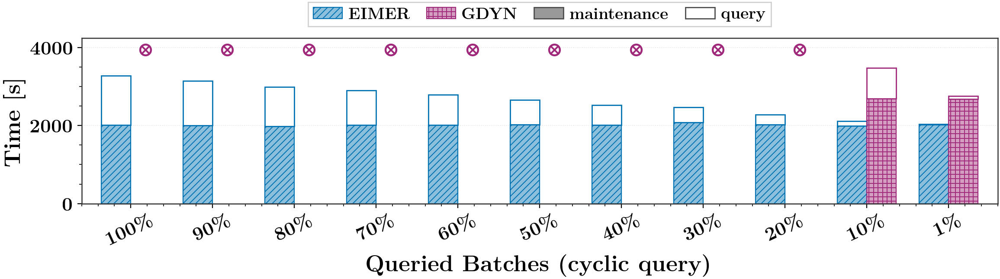

# Fig. 10b: the cyclic query under sparser query schedules, on Trino

| Parameter | Value |
|---|---|
| Paper | Fig. 10b |
| Approaches | EIMER (clique-grow's pick for the schedule), GDYN |
| Query | chain with a window between its first and last variable (cyclic) |
| Table size N | 50,000 |
| Batches | 1,000 |
| Pattern length k | 4 |
| Window W | 1 s |
| Band selectivity | 0.01 |
| Event types | eight, each at 5 % of the rows |
| Query schedule | 100 % to 10 % and 1 % of the batches, evenly spaced, the last batch included |

Filled: maintenance; white: query time. EIMER takes 3,280 s when every batch is queried and 2,036 s at 1 %: its maintenance stays
at about 2,000 s, and its query time falls with the number of queried batches. GDYN finishes only at 10 % and 1 % of the batches
(3,478 s and 2,755 s, 1.6x and 1.4x slower than EIMER); it does not finish at denser schedules.

