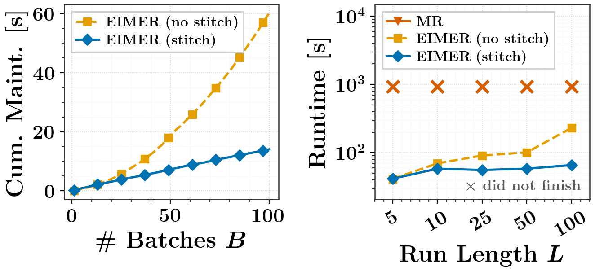

# Fig. 11a: Kleene patterns, on Trino

| Parameter | Value |
|---|---|
| Paper | Fig. 11a |
| Approaches | left: one Kleene view maintained by rescan (no stitch) and by incremental stitching; right: native MR, EIMER without and with stitching (clique-grow's pick) |
| Query | left: one Kleene variable, `C+`; right: `A Z* B Z* C+ Z* D` with conditions between A, B and D |
| Table size N | 100,000 |
| Batches | 100 (1,000 rows per batch) |
| Pattern length k | 4 (right) |
| Window W | none |
| Band selectivity | 0.01 |
| Event types | A, B and D at 0.5 % of the rows each; C in runs of length L = 30 (left) and L = 5 to 100 (right) |
| Query schedule | after every batch |

Left: the cumulative maintenance time of the Kleene view. Stitching needs 13 s to 16 s over the 100 batches, the rescan
59 s to 61 s (three seeds), so stitching is 3.9x to 4.7x faster. Right: native MR does not finish at any run length (time
limit of 2 hours). EIMER with stitching takes 42 s to 66 s; without it the runtime grows from 42 s at L = 5 to 232 s at
L = 100, where stitching is 3.5x faster.

