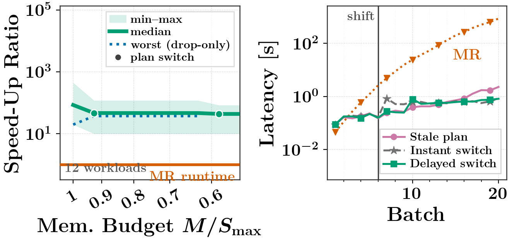

# Fig. 11b and 11c: storage budget and distribution shift, on Trino

| Parameter | Value |
|---|---|
| Paper | Fig. 11b (storage budget), Fig. 11c (distribution shift) |
| Approaches | native MR, EIMER; budget: every strategy of the budget descent, from clique-grow's pick to single-variable views only; shift: the stale strategy, re-selection right after the shift and re-selection three batches later |
| Query | budget: chain, star, triangle, diamond, cycle and complete topologies without a window; shift: chain |
| Table size N | budget: 5,000 to 12,000; shift: 10,000 |
| Batches | budget: 25 (one workload: 100); shift: 20 |
| Pattern length k | budget: 4 to 6; shift: 4 |
| Window W | none |
| Band selectivity | budget: 0.002 to 0.05; shift: 0.0125 before and 0.25 after batch 6 |
| Event types | budget: each type at 2 % of the rows (one workload: 5 %); shift: 3 % before and 4.5 % after batch 6 |
| Query schedule | after every batch |

Left: the speed-up of EIMER over native MR across the 12 workloads while the storage budget M shrinks; dots mark a change of
the strategy. Every strategy of every workload is faster than native MR, by 10x to 447x. Right: latency per batch around
the shift. In total, the stale strategy takes 12.7 s, re-selection right after the shift 9.8 s and re-selection three batches
later 9.0 s; native MR takes 3,221 s.

