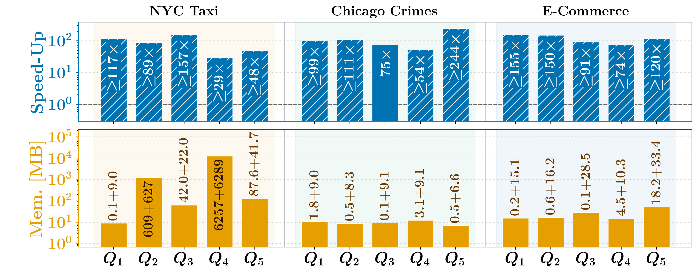

# Fig. 12: native MR and EIMER on real-world tables, on Trino

| Parameter | Value |
|---|---|
| Paper | Fig. 12 |
| Approaches | native MR, EIMER (the strategy stored in `reproducibility/reference/`) |
| Query | Q1 to Q5 on each of three tables (NYC taxi trips, Chicago crimes, e-commerce events) |
| Table size N | the first 100,000 rows of each table |
| Batches | 200 rows per batch (500 batches) |
| Pattern length k | 2 to 5 |
| Window W | per query, 30 minutes to 14 days in total (taxi Q2: none) |
| Band selectivity | - (real data) |
| Event types | - (real data) |
| Query schedule | after every batch |

EIMER finishes all 15 queries. Native MR finishes only Chicago Q3, where it is 75x slower than EIMER. For the other 14
queries, the speed-up is a lower bound (hatched): 29x to 244x. The lower panel shows EIMER's persistent state plus its
peak query memory.

