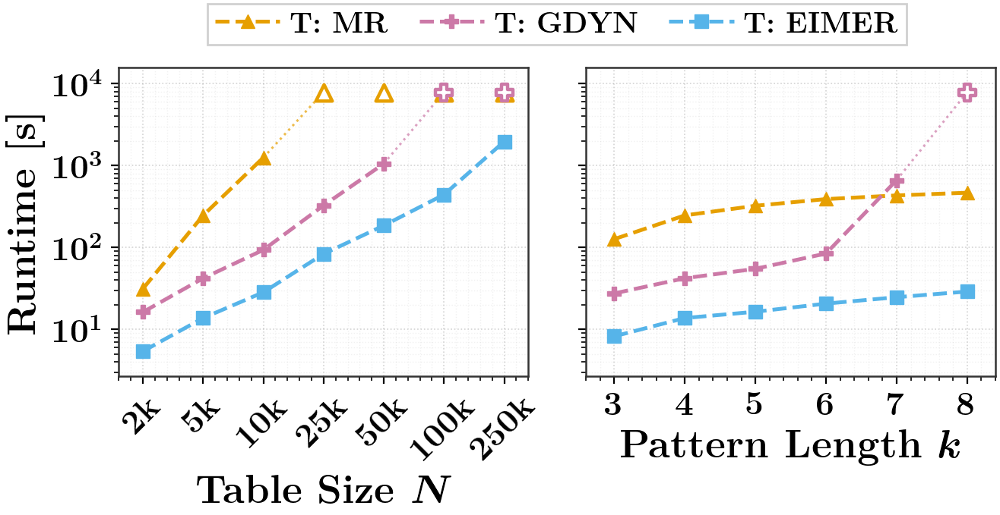

# Fig. 8a: native `MATCH_RECOGNIZE`, GDYN and EIMER on Trino

| Parameter | Value |
|---|---|
| Paper | Fig. 8a, Trino series |
| Approaches | native MR, GDYN, EIMER (clique-grow's pick) |
| Query | chain with a window between its first and last variable |
| Table size N | 2,000 to 250,000 (left panel); 5,000 (right panel) |
| Batches | 200 events per batch (left); 25 batches (right) |
| Pattern length k | 4 (left); 3 to 8 (right) |
| Window W | 1 s |
| Band selectivity | 0.05 |
| Event types | eight, each at 5 % of the rows |
| Query schedule | after every batch |

Native MR finishes up to N = 10,000 (5.8x to 44x slower than EIMER) and GDYN up to N = 50,000 (3.0x to 5.7x slower); EIMER takes
5.4 s to 1,967 s. Over k, native MR is 15x to 20x slower than EIMER, GDYN 3.3x to 27x, and GDYN does not finish at k = 8.
Hollow markers: the approach did not finish.

