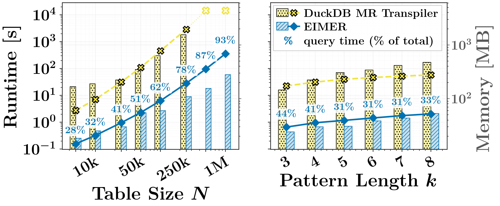

# Fig. 8b: EIMER on DuckDB vs. the transpiled `MATCH_RECOGNIZE` query

| Parameter | Value |
|---|---|
| Paper | Fig. 8b |
| Approaches | the query transpiled to SQL, re-executed after every batch; EIMER (clique-grow's pick) |
| Query | chain with a window between its first and last variable |
| Table size N | 5,000 to 1,000,000 (left panel); 25,000 (right panel) |
| Batches | 1,000 events per batch (left); 25 batches (right) |
| Pattern length k | 4 (left); 3 to 8 (right) |
| Window W | 60 ms |
| Band selectivity | 0.2 |
| Event types | five, each at 20 % of the rows |
| Query schedule | after every batch |

Over N, EIMER is 18x to 103x faster than the transpiled query, which does not finish from N = 500,000; EIMER takes 0.16 s to
357 s. Over k, EIMER is 28x to 34x faster. Bars: peak memory above the loaded table.

