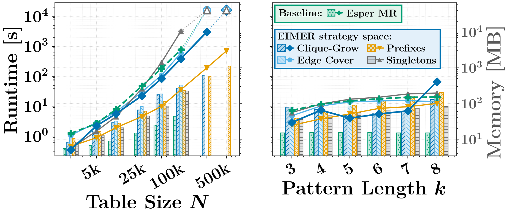

# Fig. 8c: EIMER's strategies on Esper vs. Esper's `match_recognize`

| Parameter | Value |
|---|---|
| Paper | Fig. 8c |
| Approaches | Esper's native MR; EIMER with clique-grow's pick, the edge cover, all prefixes, all singletons |
| Query | chain with a window between its first and last variable |
| Table size N | 2,000 to 500,000 (left panel); 25,000 (right panel) |
| Batches | 200 events per batch (left); 25 batches (right) |
| Pattern length k | 4 (left); 3 to 8 (right) |
| Window W | 1 s |
| Band selectivity | 0.05 |
| Event types | eight, each at 5 % of the rows |
| Query schedule | after every batch |

Lines: runtime; bars: peak memory.
