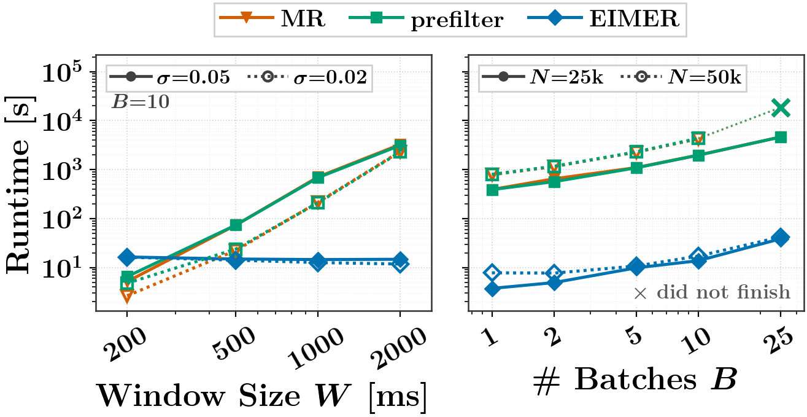

# Fig. 9: native MR, the join-based prefilter and EIMER, on Trino

| Parameter | Value |
|---|---|
| Paper | Fig. 9 |
| Approaches | native MR, the join-based prefilter (the fastest subsequence filter per workload), EIMER (clique-grow's pick) |
| Query | chain with a window between its first and last variable |
| Table size N | 10,000 (window panel); 25,000 and 50,000 (batch panel) |
| Batches | 10 (window panel); 1 to 25 (batch panel) |
| Pattern length k | 4 |
| Window W | 200 ms to 2 s (window panel); 1 s (batch panel) |
| Band selectivity | generator setting 0.05 and 0.02 (window panel), 0.05 (batch panel); the query's band is wider, its measured selectivity is about 0.1 and 0.05 |
| Event types | first and last type at 1 % of the rows each, the others at 10 % |
| Query schedule | after every batch |

The type rates and table sizes differ from the paper's Fig. 9 (see [`reproducibility/README.md`](../../README.md)). At
W = 200 ms both baselines are faster than EIMER (3 s to 7 s against 16 s). From W = 500 ms on EIMER is faster, by 1.6x to
221x over native MR: its runtime stays at 12 s to 16 s, while native MR grows to 3,265 s at W = 2 s. In the batch panel
EIMER takes 4 s to 42 s and is 100x to 247x faster than native MR; at 50,000 rows in 25 batches neither baseline finishes.
With the first and last type equally frequent, the prefilter does not help: from W = 500 ms on its runtime is within
14 % of native MR's.

