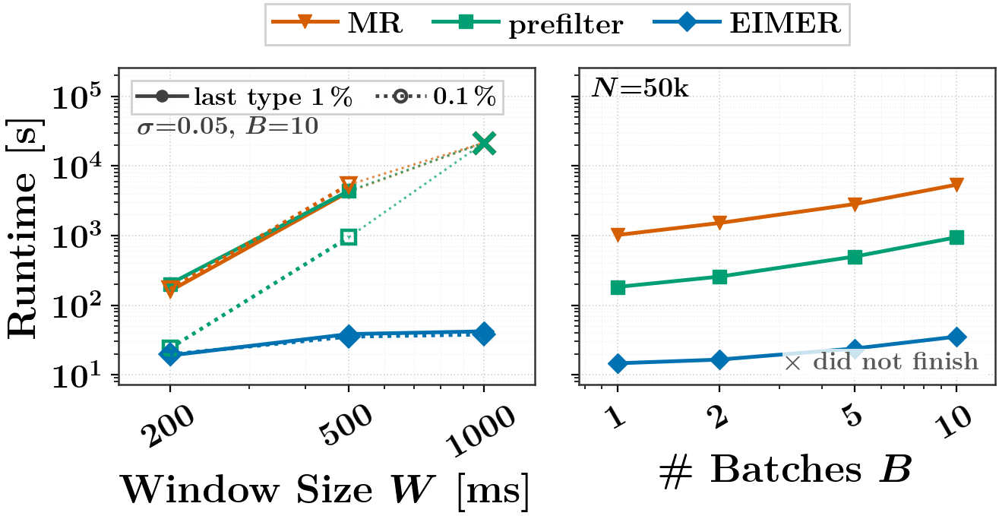

# Fig. 9 with the paper's type rates: native MR, the join-based prefilter and EIMER, on Trino

| Parameter | Value |
|---|---|
| Paper | Fig. 9 |
| Approaches | native MR, the join-based prefilter (the fastest subsequence filter per workload), EIMER (clique-grow's pick) |
| Query | chain with a window between its first and last variable |
| Table size N | 50,000 |
| Batches | 10 (window panel); 1 to 10 (batch panel) |
| Pattern length k | 4 |
| Window W | 200 ms to 1 s (window panel); 500 ms (batch panel) |
| Band selectivity | generator setting 0.05; the query's band is wider, its measured selectivity is about 0.1 |
| Event types | all types but the last at 10 % of the rows; the last type at 1 % or 0.1 % (window panel), at 0.1 % (batch panel) |
| Query schedule | after every batch |

Left: over the window size W, with the last type at 1 % or 0.1 %; right: over the number of batches B, with the last type at 0.1 % and W = 500 ms. Crosses: the approach did not finish.
