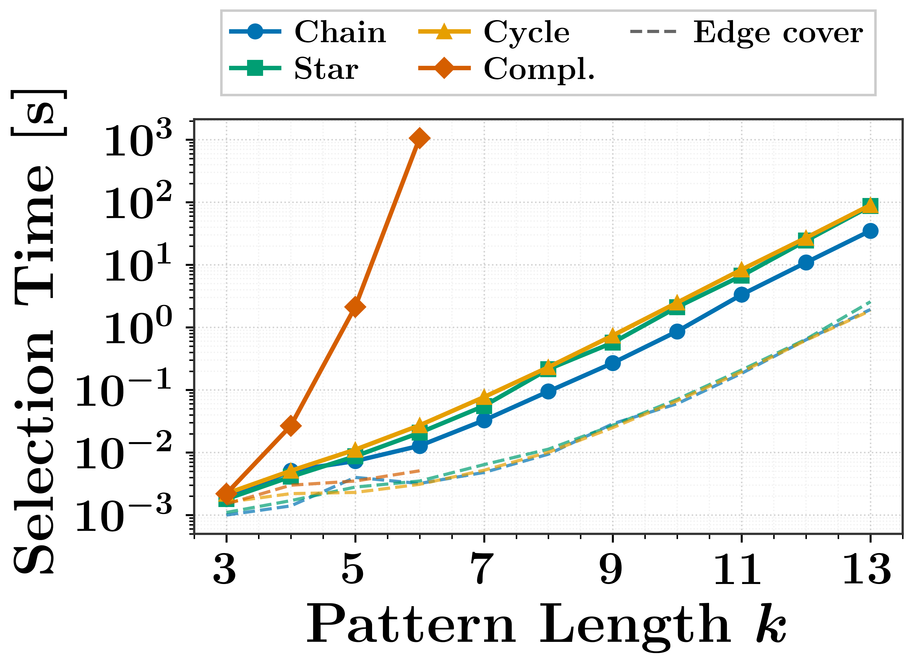

# Selection time (§7.3)

| Parameter | Value |
|---|---|
| Paper | §7.3, Selection Time (no figure in the paper) |
| Approaches | clique-grow, and its seed, the edge cover, as a selector of its own |
| Query | chain, star and cycle (k = 3 to 13), complete (k = 3 to 6), without a window |
| Table size N | 100,000 (a constant of the cost model; no engine is involved and no table is read) |
| Batches | 25 |
| Pattern length k | 3 to 13 |
| Window W | none |
| Band selectivity | 0.01 |
| Event types | each type at 5 % of the rows |
| Query schedule | after every batch |

Solid lines show clique-grow, dashed lines the edge cover; each point is the median of five runs on one core (the complete
query at k = 6: one run). On chain, star and cycle, clique-grow needs at most 11 ms up to k = 5, at most 0.23 s at k = 8, and
35 s to 91 s at k = 13. On complete queries it needs 2.1 s at k = 5 and 1,063 s at k = 6. The edge cover needs at most 2.6 s
for any query. The paper's values, measured on its server, are about 1.5x higher throughout (51 s to 144 s at k = 13;
3.2 s and 1,596 s on complete queries; at most 3.1 s for the edge cover).

