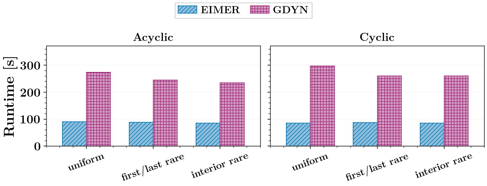

# Skewed type frequencies (§7.4), on Trino

| Parameter | Value |
|---|---|
| Paper | §7.4, Skewed Type Frequencies (no figure in the paper) |
| Approaches | EIMER (clique-grow's pick), GDYN |
| Query | chain (acyclic) and chain with a window between its first and last variable (cyclic) |
| Table size N | 25,000 |
| Batches | 125 (200 rows per batch) |
| Pattern length k | 4 |
| Window W | cyclic query: 1 s; acyclic query: none |
| Band selectivity | 0.02 |
| Event types | uniform: each type at 5 % of the rows; skewed: the first and last type, or the two interior types, at 1 % and the others at 10 % |
| Query schedule | after every batch |

Bars: total runtime.
