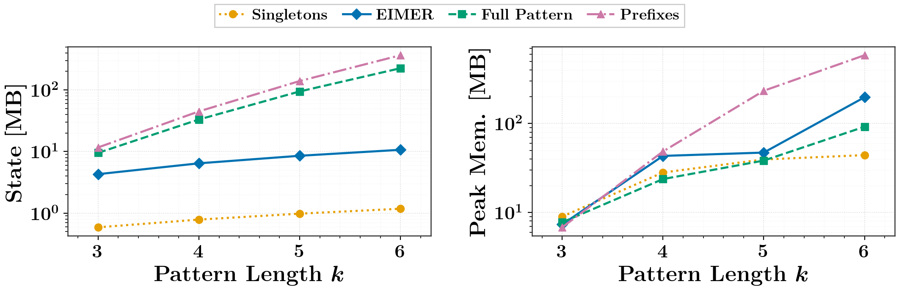

# Table 4: memory footprint of EIMER's materialization strategies, on Trino

| Parameter | Value |
|---|---|
| Paper | Table 4 |
| Approaches | EIMER with all singletons, clique-grow's pick, one view over the full pattern, all pattern prefixes |
| Query | chain |
| Table size N | 400,000 |
| Batches | 25 |
| Pattern length k | 3 to 6 |
| Window W | none |
| Band selectivity | 0.002 |
| Event types | eight, each at 2 % of the rows |
| Query schedule | after every batch |

Left: the stored state of a strategy's views at the end of the run; right: its peak query memory. At k = 6 clique-grow's pick
stores 10.7 MB, 21x less than the full pattern (225 MB) and 34x less than all prefixes (366 MB). The singletons store the
least (1.2 MB) and shift the cost to query time: their run takes 2,062 s against 35 s for the pick. The pick's peak query
memory at k = 6 (198 MB) is above that of the full pattern (92 MB) and the singletons (44 MB) and below that of all prefixes
(587 MB). All strategies return the same result. Native `MATCH_RECOGNIZE` is not part of this run.

