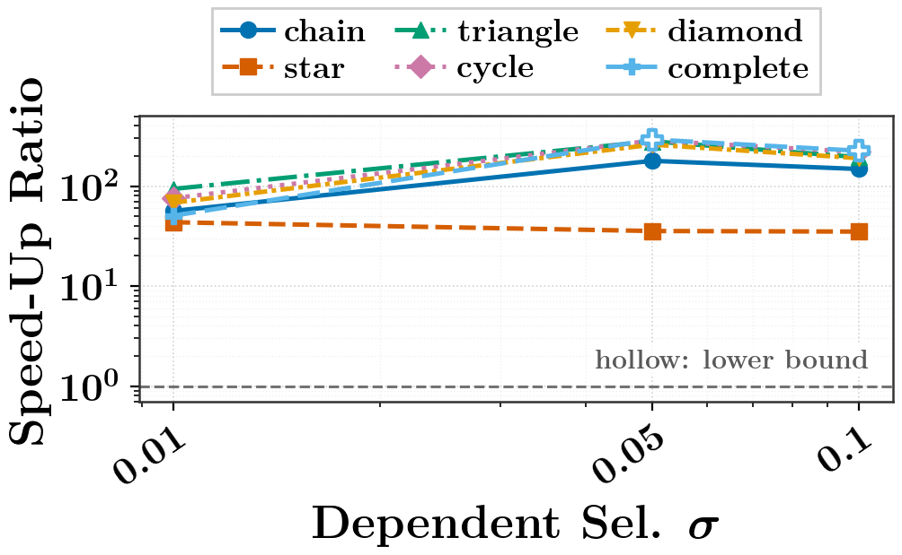

# Query topology (§7.4): native MR and EIMER on six topologies, on Trino

| Parameter | Value |
|---|---|
| Paper | §7.4, query topology (not plotted in the paper) |
| Approaches | native MR, EIMER (clique-grow's pick) |
| Query | chain, star, triangle, cycle, diamond, complete; no time window |
| Table size N | 8,000 |
| Batches | 25 |
| Pattern length k | 4 |
| Window W | none |
| Band selectivity | 0.01, 0.05, 0.1 |
| Event types | eight, each at 2 % of the rows |
| Query schedule | after every batch |

The figure shows EIMER's speed-up over native MR. EIMER takes 12 s to 32 s in all 18 workloads. Native MR takes 564 s to
7,390 s; for the complete topology at selectivity 0.05 and 0.1 it does not finish within two hours (hollow markers: the
speed-up is at least 292x and 226x). The speed-up is 43x to 94x at selectivity 0.01, 35x to 285x at 0.05 and 35x to 220x
at 0.1.

This differs from the paper's §7.4, where the speed-up shrinks as the conditions loosen (120x to 169x at 0.01, 15x to
23x at 0.1). On Trino it does not shrink: from 0.01 to 0.05, native MR becomes 6x to 7x slower on chain, triangle,
cycle and diamond, while EIMER's runtime at most doubles. On the star, native MR slows down by 1.6x only, and the speed-up
stays at 35x to 43x. All approaches return the same result wherever native MR finishes.

